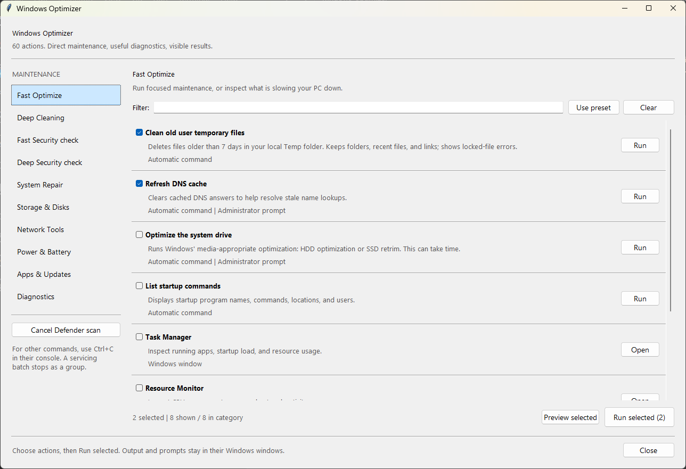

# Windows Optimizer

[](https://github.com/Kartik13-op/windows-system-optimizer/actions/workflows/ci.yml)
[](https://www.python.org/downloads/windows/)
[](https://www.microsoft.com/windows/)

A Tkinter maintenance dashboard for Windows 10/11 with 60 actions across 10 categories. It can directly start cleanup, Defender scans, Windows repair, disk maintenance, diagnostics, reports, and app updates. Python 3.10+ with Tkinter is needed only when running the source or building.



Windows Optimizer is intentionally a launcher and coordinator for documented Windows facilities. It does not install a background service, remain in the notification area, change settings at startup, upload telemetry, download third-party “tweaks,” or apply undocumented registry presets. The source of every action is readable in [`maintenance.py`](./maintenance.py), and the exact generated PowerShell can be inspected with **Preview selected** before it runs.

For the complete behavior, elevation requirement, expected side effects, and Microsoft references for every action, see [Action Reference](./docs/ACTIONS.md).

## Why this project is trustworthy

- **No hidden work:** commands run only after you select **Run** or **Run selected**. Selecting a category, filtering, or previewing performs no maintenance.
- **Visible commands and output:** PowerShell consoles stay open and use normal progress/error output. The code contains no `SilentlyContinue` action policy and makes no success claim after merely launching a command.
- **Normal Windows consent:** administrator actions use the standard UAC prompt. Canceling UAC is treated as a visible launch error; the app does not bypass elevation.
- **Bounded cleanup:** automated temp cleanup targets only the expected user or Windows Temp directory, only files older than seven days, and skips directories, recent files, and reparse points/links.
- **Conservative presets:** repair, power-plan changes, Winsock reset, component cleanup, and mass app upgrades are clearly named and are not hidden inside the Fast Optimize preset.
- **No persistence or telemetry:** there is no scheduled task, autorun entry, analytics SDK, network API, account, updater, or background process added by this application.
- **Reproducible build path:** the executable is produced from this repository by a short, documented pipeline with pinned build-tool versions and tests before packaging.
- **Honest limitations:** Windows tools decide whether an operation is supported and successful. The app keeps their messages visible and does not promise universal speed improvements.

## Run

Download `WindowsOptimizer.exe` from the [GitHub Releases page](https://github.com/Kartik13-op/windows-system-optimizer/releases), or build it from source. The standalone executable includes Python and Tkinter.

Windows may show a SmartScreen warning for an unsigned community build. Check that the release came from this repository, compare its SHA-256 value with the release notes when one is published, or build the executable yourself:

```powershell
Get-FileHash .\WindowsOptimizer.exe -Algorithm SHA256
```

The project does not currently claim a code-signing identity. That is stated explicitly so users can make an informed decision instead of mistaking packaging for publisher verification.

To run the source, double-click **Start.cmd**, or use:

```powershell
python .\windows_optimizer.pyw
```

| Category | Examples |
| --- | --- |
| Fast Optimize | Aged temp cleanup, DNS refresh, media-aware drive optimization, startup inventory, resource tools |
| Deep Cleaning | User/Windows temp cleanup, Delivery Optimization cache, component-store analysis and cleanup |
| Fast/Deep Security | Defender signature updates, direct quick/full scans, scan cancellation, protection and threat history |
| System Repair | Restore point, DISM checks/repair, SFC verification/repair, memory diagnostics |
| Storage & Disks | Space/health reports, CHKDSK online scan, TRIM status, drive analysis and optimization |
| Network Tools | DNS refresh, connection tests, Wi-Fi report, configuration, targeted Winsock reset |
| Power & Battery | Power-plan controls, battery/energy reports, sleep blockers and wake history |
| Apps & Updates | WinGet update discovery/installation, installed apps, hotfixes, Windows Update |
| Diagnostics | System summary, event errors, startup inventory, Reliability Monitor, Event Viewer |

Selecting a category shows detailed actions. Select any combination and use **Run selected**, run one action directly, or use **Preview selected** to inspect the exact commands first. Presets choose conservative starting actions. Search filters the visible rows without discarding selected actions.

Commands run in visible PowerShell consoles and administrator actions display the normal Windows UAC prompt. Output, progress, warnings, agreement prompts, and errors remain visible. DISM/SFC commands selected together run sequentially in one console so servicing operations do not compete.

Ctrl+C stops the command attached to a console. Defender scans can continue after their console closes, so the app has a dedicated **Cancel Defender scan** action backed by Defender's cancellation command. The app does not poll for completion or claim that maintenance succeeded.

Automated temp cleanup is limited to files older than seven days inside the expected user or Windows Temp directory. It preserves directories and recent files, skips reparse points/links, and prints locked-file errors. It does not touch documents, downloads, browser profiles, application data outside Temp, or arbitrary cache folders.

Actions that can materially change configuration—power-plan switches, Winsock reset, full app upgrades, Windows repairs, and component cleanup—are individually named and described. None of them are hidden inside the default Fast Optimize preset.

## What the application will never do automatically

- Disable Microsoft Defender, Windows Update, the firewall, UAC, or security mitigations.
- Delete documents, downloads, browser profiles, restore points, or arbitrary application caches.
- Apply timer, HPET, MTU, DNS-server, CPU parking, pagefile, service-disabling, or “gaming registry” recipes.
- Accept WinGet license prompts, restart Windows, schedule CHKDSK repairs, or choose Defender remediation on your behalf.
- Report a task as completed merely because its process launched.

Some actions are inherently consequential even when they use supported Windows tools. Read the description, use **Preview selected**, save open work, and run only the actions you understand.

## Build an executable

From this folder, run:

```powershell
powershell -NoProfile -ExecutionPolicy Bypass -File .\build.ps1
```

The build creates an isolated `.venv-build`, installs the pinned packages in `requirements-build.txt`, and runs the `exe` task in `build.py` through **PyBuilder**. That task uses **PyInstaller** to produce the single-file, windowed app at `dist\WindowsOptimizer.exe`. Downloads require internet on the first build. Build errors and dependency-install output remain visible.

### Build pipeline

```text
build.ps1
  -> creates .venv-build
  -> installs exact versions from requirements-build.txt
  -> runs the regression suite
  -> invokes the PyBuilder "exe" task in build.py
  -> PyInstaller analyzes windows_optimizer.pyw and its imports
  -> writes dist/WindowsOptimizer.exe
```

`dist/`, build caches, virtual environments, PyInstaller specs, and the local `Release Templates/` workspace are ignored by Git. GitHub Actions repeats the Windows build on pushes and pull requests and uploads the executable as a workflow artifact. A maintainer can then verify and attach that artifact to a release; the repository does not silently publish from a developer machine.

To use a specific Python interpreter:

```powershell
.\build.ps1 -Python 'C:\path\to\python.exe'
```

Build and dependency errors stop the build. These checks concern packaging, not the completion of Windows maintenance operations.

## Verification

```powershell
python -m unittest discover -s tests -v
```

The build runs the tests before packaging. The suite validates every category reference, command visibility, temp-cleanup boundaries, Settings/native launch routing, elevation, canceled prompts, bundled DLL handling, filters, presets, conflicting choices, and sequential servicing batches. Tests do not start maintenance operations.

## Architecture and review path

| File | Responsibility |
| --- | --- |
| [`windows_optimizer.pyw`](./windows_optimizer.pyw) | Tkinter interface, selection, presets, filtering, previews, and grouping rules |
| [`maintenance.py`](./maintenance.py) | Declarative catalog of names, descriptions, exact commands, elevation, and servicing metadata |
| [`launcher.py`](./launcher.py) | Windows process/UAC launching, Settings URI activation, and visible PowerShell command construction |
| [`tests/test_app.py`](./tests/test_app.py) | Catalog integrity, command parsing, cleanup boundaries, GUI selection, elevation, and launcher regression tests |
| [`tests/test_repository.py`](./tests/test_repository.py) | Action-reference coverage, README image, relative-link, community-file, and release-workspace checks |
| [`build.ps1`](./build.ps1) | Isolated, fail-fast build entry point |
| [`build.py`](./build.py) | PyBuilder task that invokes PyInstaller |
| [`requirements-build.txt`](./requirements-build.txt) | Pinned executable-build dependencies |

The runtime uses Python's standard library and Windows' built-in commands. PyBuilder and PyInstaller are build-time dependencies only.

## Windows launch behavior

Standalone tools launch directly as native executables; Settings URIs are passed to Windows Explorer for shell activation. The app handles 32-bit Python's System32 redirection. It avoids the old Control Panel Power Options route associated with the reported `Server execution failed` message and uses `ms-settings:powersleep` instead. Windows Security opens through its documented Settings page rather than requiring a direct `windowsdefender:` app association.

If Windows itself cannot open a page, its popup remains visible. If the same page also fails when opened from the Windows Start menu, the Windows installation or its policy needs separate diagnosis.

## Known limitations

- Windows editions, organizational policies, installed antivirus products, hardware, and filesystems can make some actions unavailable.
- Defender actions require Microsoft Defender Antivirus to be active; another security provider may manage scans instead.
- WinGet actions require Windows Package Manager and may display installer, agreement, or UAC prompts.
- DISM, SFC, Defender full scans, drive optimization, and energy analysis can take a long time. Closing this GUI does not cancel processes already handed to Windows.
- Results are diagnostic, not a guarantee that hardware, malware, filesystem, or operating-system problems are repaired.
- The executable is not currently code-signed. Source builds provide the strongest verification path until signing is established.

## Contributing, support, and security

Read [CONTRIBUTING.md](./CONTRIBUTING.md) before proposing a new maintenance action. Every new action should use a documented Windows facility, declare elevation and side effects, provide a primary source, remain previewable, and include focused tests.

Use the GitHub issue forms for reproducible bugs and feature proposals. General usage guidance is in [SUPPORT.md](./SUPPORT.md). Please do not publish suspected security vulnerabilities in a public issue; follow [SECURITY.md](./SECURITY.md) instead.

Release history is kept in [CHANGELOG.md](./CHANGELOG.md), with detailed notes under [`docs/releases/`](./docs/releases/). The local `Release Templates/` folder is intentionally ignored so draft assets and checksums cannot be mistaken for an official published release.

## Project status and licensing

Windows Optimizer is an independently developed utility and is not affiliated with or endorsed by Microsoft. “Windows” and related product names belong to Microsoft.

No open-source license has been selected yet. Until a license file is added, normal copyright rules apply: the source is public for inspection, but redistribution and modification rights are not automatically granted. This is documented plainly rather than implying permissions the repository has not established.
